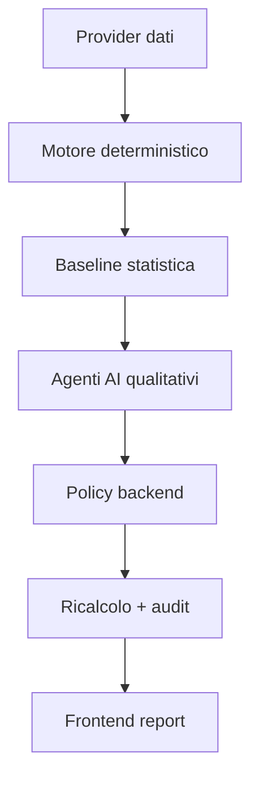

# Enterprise Football Prediction Engine - Handoff Tecnico per Claude

## Finalità

Costruire un sistema enterprise per analisi predittiva calcistica:

- quantitativo;
- probabilistico;
- spiegabile;
- verificabile;
- aggiornabile;
- replicabile;
- auditabile;
- pronto per deploy Render.

Il sistema produce analisi di singole partite e ranking Top 5/6/7 giornalieri con quote e simulazione di stake.

## Stato Attuale

Versione: `1.8.0`

Stack:

- Node.js 20;
- HTTP server nativo;
- frontend statico HTML/CSS/JS;
- nessuna dipendenza runtime esterna;
- Dockerfile;
- Render Blueprint;
- provider dati: ESPN pubblico senza chiave (default), API-Football con chiave, snapshot incorporato, demo;
- app iPhone (PWA) generata da `npm run build:pwa`, pubblicata su https://flleone93.github.io/football-engine/ tramite GitHub Actions (`src/browser/mobileEntry.js`, `src/browser/idbLedgerStorage.js`, `mobile/sw.js`);
- Artifact claude.ai generato da `npm run build:live` con agenti AI eseguiti da Claude (capability `sample`);
- adapter AI: Gemini Interactions API, OpenAI Responses API (Structured Outputs) oppure Claude nel runtime Artifact.

## Architettura



## Separazione dei Layer

Ogni analisi deve mantenere separati:

1. dati provenienti da fonti reali;
2. risultati dei modelli statistici;
3. valutazioni qualitative AI;
4. inferenze non confermate;
5. raccomandazione finale.

Nel JSON questa separazione è in:

```json
{
  "layers": {
    "realData": {},
    "statisticalBaseline": {},
    "qualitativeAssessments": {},
    "unconfirmedInferences": [],
    "finalRecommendation": {}
  }
}
```

## Moduli Deterministici

Restano codice, non LLM:

- Data Acquisition;
- Entity Resolution;
- Data Quality;
- Feature Engineering;
- Poisson/Dixon-Coles;
- Monte Carlo;
- Market Odds e de-vig;
- Model Ensemble;
- coerenza strutturale matrice/ensemble;
- Top Picks;
- Expected Value;
- Governance e Audit.

File principali:

- `src/prediction/engine.js`
- `src/prediction/probability.js`
- `src/prediction/monteCarlo.js`
- `src/prediction/recommendation.js`
- `src/prediction/topPicks.js`
- `src/providers/apiFootball.js`
- `src/providers/demo.js`
- `src/providers/espn.js` (dati reali senza chiave)
- `src/providers/snapshot.js` (dati reali incorporati)
- `src/tracking/predictionLedger.js` (registro previsioni append-only)
- `src/tracking/metrics.js` (Brier, log loss, RPS, calibrazione, ROI)
- `src/tracking/fileStorage.js` (persistenza JSONL, solo server)

## Agenti AI

Agenti previsti:

| Agent ID | Nome | Ruolo |
|---|---|---|
| `player_availability_impact` | Player Availability & Impact Agent | Disponibilità e impatto giocatori |
| `tactical_context` | Tactical Context Agent | Matchup tattici e ritmo |
| `news_intelligence` | News Intelligence Agent | News e comunicati presenti nel payload |
| `competition_context` | Competition Context Agent | Regolamento, motivazioni, contesto competizione |
| `challenge_bias` | Challenge & Bias Detection Agent | Bias, contraddizioni, overconfidence |
| `final_explanation` | Final Explanation Agent | Report leggibile finale |

File:

- `src/ai/schemas.js`
- `src/ai/structuredClient.js`
- `src/ai/openaiClient.js` (re-export di compatibilità)
- `src/ai/orchestrator.js`
- `src/ai/usageLedger.js`

## Regola Fondamentale AI

L'AI non deve inventare:

- dati;
- quote;
- formazioni;
- news;
- infortuni;
- probabilità finali.

L'AI può solo:

- riassumere evidenze ricevute;
- dichiarare dati insufficienti;
- proporre piccoli aggiustamenti xG;
- proporre penalità di confidenza nel challenge;
- spiegare il risultato finale.

Il backend applica o rifiuta ogni proposta.

## Policy Aggiustamenti

Variabili:

```env
AI_MIN_EFFECT_CONFIDENCE=0.55
AI_DUPLICATE_EVIDENCE_SCALE=0.50
AI_MAX_PLAYER_XG_DELTA=0.12
AI_MAX_TACTICAL_XG_DELTA=0.08
AI_MAX_NEWS_XG_DELTA=0.04
AI_MAX_COMPETITION_XG_DELTA=0.06
AI_MAX_TOTAL_XG_DELTA=0.20
AI_MAX_PROBABILITY_SHIFT_PP=5
AI_MAX_CHALLENGE_CONFIDENCE_PENALTY=8
```

Processo:

1. baseline deterministica;
2. output agenti JSON;
3. validazione schema, evidence ID e indici;
4. filtro per confidenza minima;
5. cap cumulativo per agente;
6. cap sulla somma assoluta delle variazioni xG;
7. deduplicazione controllata delle evidenze riutilizzate tra agenti;
8. ricalcolo;
9. guardrail su shift probabilità;
10. challenge;
11. explanation;
12. audit finale.

Ogni agente riceve un payload minimizzato per dominio. I fallback di fonti fallite sono esclusi prima della costruzione del prompt usando `sourceStatus`.

## Modalità AI

```env
AI_MODE=off
AI_MODE=shadow
AI_MODE=active
```

- `off`: solo deterministico;
- `shadow`: agenti eseguiti ma effetti non applicati;
- `active`: effetti applicati con guardrail.

## Cache

Cache analisi:

```text
fixtureId + dataVersion + neutral + aiMode + provider + models + limits
```

Cache agenti:

```text
agentId + provider + model + evidencePackHash + promptHash
```

TTL:

```env
CACHE_TTL_SECONDS=900
AI_AGENT_CACHE_TTL_SECONDS=3600
```

## Cost Control

Variabili:

```env
AI_DAILY_CALL_LIMIT=500
AI_DAILY_TOKEN_LIMIT=1000000
AI_DAILY_COST_LIMIT_USD=25
AI_MAX_CALLS_PER_ANALYSIS=6
AI_MAX_CONCURRENCY=2
TOP_PICKS_AI_ENABLED=false
```

Top Picks usa AI solo se `TOP_PICKS_AI_ENABLED=true`, e comunque su shortlist.

Soglie qualità Top Picks:

```env
TOP_PICKS_MIN_PROBABILITY=0.55
TOP_PICKS_MIN_CONFIDENCE=45
TOP_PICKS_MIN_DATA_QUALITY=40
TOP_PICKS_REQUIRE_POSITIVE_EV=false
```

## API

Endpoint:

- `GET /api/health`
- `GET /api/ready`
- `GET /api/meta`
- `GET /api/fixtures`
- `POST /api/analyze`
- `POST /api/top-picks`
- `GET /api/usage`
- `GET /api/performance`
- `GET /api/performance/records`
- `POST /api/performance/settle` (admin)

`/api/usage` restituisce aggregati pubblici. Con `ADMIN_API_TOKEN` e header Bearer include i dettagli recenti degli errori.

Payload analisi:

```json
{
  "fixtureId": "demo-france-spain",
  "neutral": true,
  "refresh": false,
  "useAi": true
}
```

Payload Top Picks:

```json
{
  "date": "2026-07-18",
  "limit": 5,
  "stake": 10
}
```

Output quantitativi aggiuntivi della release 1.4:

- `progression`: supplementari, rigori e qualificazione solo con regole confermate;
- `timeline`: baseline temporale con caveat esplicito;
- `summary.uncertainty`: entropia e rischio di non-vittoria della favorita;
- `exactScores[].outcome` e `exactScores[].contributionToOutcome`.

La provenienza usa `sourceStatus`: oggetti fallback vuoti non sono dichiarati dati osservati quando la richiesta upstream è fallita. La decision trace AI conserva il valore finale applicato dopo cap per agente e scala globale.

## Sicurezza

Implementato:

- chiavi solo in backend;
- CSP restrittiva;
- rate limit generale e endpoint costosi;
- body limit;
- catalogo evidenze AI deterministico;
- budget chiamate/token/costo riservato prima della concorrenza;
- errori pubblici generici;
- audit log sanitizzato;
- Docker non-root;
- `.dockerignore`;
- `.gitignore` per `.env`.

## Frontend

File:

- `public/index.html`
- `public/styles.css`
- `public/app.js`

Funzionalità:

- calendario autoaggiornato;
- filtri per data, competizione, ricerca;
- analisi partita;
- Top Picks giornalieri;
- simulazione stake;
- report con layer separati;
- tab accessibili;
- stato AI;
- 1X2 al 90' distinto dalla qualificazione;
- probabilità di supplementari/rigori solo con regole confermate;
- timeline, incertezza e contributo dei risultati esatti;
- responsive design;
- tab Performance: metriche post-partita, calibrazione, benchmark mercato, ROI indicazioni;
- export JSON dell'analisi, stampa/PDF, export CSV del registro.

Il frontend non contiene logica predittiva: tutto arriva dal backend.

## Deploy Render

File: `render.yaml`

Variabili consigliate:

```env
DEMO_MODE=false
API_FOOTBALL_KEY=...
GEMINI_API_KEY=...
AI_MODE=active
AI_PROVIDER=gemini
TRUST_PROXY=true
HOST=0.0.0.0
```

Configurazione alternativa OpenAI:

```env
AI_PROVIDER=openai
OPENAI_API_KEY=...
OPENAI_MODEL_DEFAULT=gpt-5.6-luna
OPENAI_MODEL_CHALLENGE=gpt-5.6-terra
OPENAI_MODEL_EXPLANATION=gpt-5.6-luna
```

## Test

```bash
npm test
node --check src/server.js
node --check public/app.js
```

Copertura attuale:

- motore completo;
- partite demo;
- normalizzazione probabilità;
- coerenza matrice/ensemble;
- mercati complementari;
- Top Picks;
- stake simulation;
- guardrail AI;
- adapter e payload Gemini/OpenAI;
- cap cumulativi e budget concorrenti;
- costo cached token senza doppio conteggio;
- cinque layer;
- metriche post-partita, registro previsioni, persistenza JSONL, endpoint Performance.

## Limitazioni Note

- Nessun database persistente incluso.
- Cache, rate limit e ledger costi AI in memoria si azzerano al restart; il registro previsioni live è persistente solo se `data/` è su volume.
- API-Football non fornisce sempre news, meteo o lineups ufficiali in anticipo.
- L'AI live richiede chiave e costi API.
- Top Picks con AI va tenuto su shortlist per controllo costi.
- La calibrazione empirica è misurata (tab Performance) ma non applicata automaticamente ai numeri.
- La forma recente live e filtrata temporalmente; per backtest storico completo il provider deve restituire la finestra as-of corretta.

## Estensioni Future

- Redis per cache condivisa su più istanze.
- Database condiviso per il registro previsioni (multiistanza).
- Aggiornamento pesi/curve dopo validazione fuori campione.
- Scheduler aggiornamenti.
- News provider dedicato.
- Meteo provider.
- Authentication admin.
- Alert automatici su drift di calibrazione.
